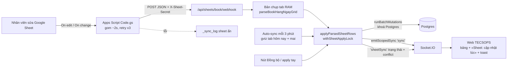

# Báo cáo: đồng bộ Google Sheet «BOOK HẰNG NGÀY» realtime

Branch: `feat/sheet-realtime`, gồm 3 commit cục bộ. **Chưa push, chưa deploy, chưa đặt env trên Railway**; các bước này chờ anh Nam duyệt.

## Kết quả

Khi nhân viên sửa Sheet, Apps Script gửi các dòng vừa sửa lên webhook. Server khớp và áp bằng **đúng lõi của nút Đồng bộ**, rồi broadcast một lần qua Socket.IO, nên web cập nhật sau khoảng 1–3 giây. Webhook lỡ lần nào thì job auto-sync (mỗi 3 phút, tab hôm nay + ngày mai) sẽ bắt lại. Nút Đồng bộ cũ giữ nguyên.

## Kiến trúc



Chi tiết các lựa chọn thiết kế nằm trong [`DECISIONS.md`](./DECISIONS.md).

## File sửa / thêm

| File | Nội dung |
|---|---|
| `server/sheets/sheetApply.mjs` (mới) | Lõi khớp/áp tách từ `POST /apply`: `applyParsedSheetRows`, `withSheetApplyLock`, `loadBookGridForSession`, `buildAwbIndexes`… |
| `server/sheets/sheetsRoutes.mjs` | `apply` gọi lõi chung; **response giữ nguyên**. Đăng ký thêm route webhook. |
| `server/sheets/sheetWebhook.mjs` (mới) | `POST /api/sheets/book/webhook`, `GET /api/sheets/book/realtime-status`, bản chụp tab, lọc trùng, suy ngày từ tên tab |
| `server/sheets/sheetAutoSync.mjs` (mới) | Job `SHEET_AUTO_SYNC` |
| `server/sheets/sheetRealtimeStatus.mjs` (mới) | Lần cập nhật gần nhất + emit socket `sheetSync` |
| `server/index.mjs` | Gọi `startSheetAutoSync({ io })` sau khi listen |
| `server/sheets/sheetWebhook.test.mjs` (mới) | 20 test webhook + auto-sync |
| `src/utils/sheetRealtime.ts` (+ test), `src/hooks/useSheetRealtimeStatus.ts`, `src/components/SheetSyncedBadge.tsx` (mới) | Trạng thái và toast phía web |
| `src/hooks/useShipmentSync.ts` | Chuyển socket `sheetSync` thành window event |
| `src/components/AirCargoTracking.tsx`, `OpsDesktopCommandBar.tsx`, `OpsMobileStickyHeader.tsx` | Hiện «Sheet: cập nhật lúc HH:mm:ss» và toast conflict |
| `tools/apps-script/Code.gs`, `tools/apps-script/README.md` (mới) | Script cho Sheet + hướng dẫn cài |
| `docs/sheet-realtime/DECISIONS.md`, `REPORT.md` (mới) | Tài liệu |

Không đổi schema Postgres, không đổi login/auth, không thêm dependency.

## Kiểm tra đã chạy (local)

| Lệnh | Kết quả |
|---|---|
| `npm run lint` | PASS |
| `npm run lint:server` | PASS |
| `npm run typecheck` | PASS |
| `npm test` | PASS: 130 file, 806 test |
| `npm run build` | PASS (chỉ có cảnh báo chunk > 500 kB, đã có từ trước) |
| `npm run deploy:check` | PASS |

Test webhook bao phủ các trường hợp sau:
- Sai hoặc thiếu secret trả 401; thiếu env trả 503; `sheetId` sai trả 400; quá 200 dòng trả 400.
- Dòng mới thì INSERT; dòng đổi thì UPDATE và giữ field chỉ có trên web; dòng không đổi thì không ghi, không broadcast.
- AWB ở phiên khác hoặc trùng trong Sheet bị skip kèm lý do.
- Request trùng trong 5 giây bị bỏ qua.
- Chưa có bản chụp tab thì trả `needFullTab`.
- AWB thiếu số thì chờ, không tạo lô.
- Auto-sync **chờ khoá** khi webhook đang ghi; auto-sync không có thay đổi thì không broadcast.
- Suy năm đúng qua giao thừa; ranh giới ngày theo giờ VN.

## Env mới cần đặt trên Railway

| Biến | Giá trị | Ghi chú |
|---|---|---|
| `SHEET_WEBHOOK_SECRET` | chuỗi ngẫu nhiên ≥ 32 byte | Thiếu biến này thì webhook **tắt** (503) |
| `SHEET_AUTO_SYNC` | `1` | Bật auto-sync dự phòng; không đặt thì tắt |
| `SHEET_AUTO_SYNC_MINUTES` | `3` | Tuỳ chọn, từ 1 đến 120 phút, mặc định 3 |

Tạo secret mạnh bằng một trong hai lệnh:

```powershell
node -e "console.log(require('crypto').randomBytes(32).toString('base64url'))"
```

```bash
openssl rand -base64 32 | tr '+/' '-_' | tr -d '='
```

Dán cùng một chuỗi vào Railway (`SHEET_WEBHOOK_SECRET`) và vào Script Property `SHEET_SECRET` của Apps Script. Không commit chuỗi này.

## Cài Apps Script

Làm theo [`tools/apps-script/README.md`](../../tools/apps-script/README.md). Tóm tắt:
1. Mở Sheet, vào Extensions → Apps Script, dán `Code.gs`.
2. Thêm Script properties `WEBHOOK_URL` = `https://<domain>/api/sheets/book/webhook` và `SHEET_SECRET`.
3. Chạy `setup()` và cấp quyền.
4. Chạy `testPush()` để kiểm tra.

## Kiểm tra sau deploy

1. Log Railway khi khởi động có `[api] sheets (BOOK Hằng Ngày)`. Nếu đã bật auto-sync thì có thêm `[sheets/auto-sync] bật — mỗi 3 phút`.
2. Endpoint bật và chặn đúng:
   ```bash
   curl -i -X POST https://<domain>/api/sheets/book/webhook -H "Content-Type: application/json" -d "{}"
   ```
   Kết quả mong đợi: **401** khi đã đặt secret, **503** khi chưa đặt.
3. Trong Apps Script, chạy `testPush()` trên một dòng có AWB: log có `ok: true`. Log Railway có dòng `[sheets/webhook] tab=«…» … added=… updated=…`.
4. Mở web ở ngày tương ứng, sửa số kiện/kg một dòng trên Sheet: bảng đổi sau 1–3 giây và thanh trên cùng hiện «Sheet: cập nhật lúc …».
5. Gõ một AWB đã có ở ngày khác vào tab hôm nay: web hiện toast cảnh báo và không tạo lô.
6. Mở sheet ẩn `_sync_log`: không có dòng lỗi mới.

## Rủi ro còn lại

- **Một replica:** khoá áp, bản chụp tab và trạng thái đều in-memory. Nếu scale Railway lên nhiều replica thì cần chuyển sang khoá Postgres hoặc Redis (Socket.IO hiện cũng đang giả định một replica).
- **Restart server:** bản chụp tab bị mất. Lần sửa đầu tiên sau restart tốn thêm một vòng gửi cả tab (`needFullTab`), chậm hơn khoảng 1–2 giây.
- **Quota Apps Script:** mỗi lần sửa có `Utilities.sleep(2 s)`. Tài khoản Google thường có quota khoảng 90 phút chạy trigger mỗi ngày (Workspace khoảng 6 giờ). Nếu ngày đông người sửa thì nên theo dõi trang Executions. Hết quota thì auto-sync vẫn bắt lại sau tối đa 3 phút.
- **Rate limit 60 request/phút/IP:** request từ Apps Script đi ra qua IP chung của Google. Tab rất lớn gửi cả tab cũng tốn nhiều request. Nếu thấy 429 trong `_sync_log` thì tăng giới hạn trong `createSheetWebhookHandler`.
- **Không tự xoá và không tự sắp STT:** xoá dòng trên Sheet không xoá lô trên web; lô mới nằm cuối kho. Dùng nút Đồng bộ khi cần dọn hoặc sắp lại.
- **Sửa dòng tiêu đề khối (TCS/SCSC) bằng `onEdit`:** script không gửi dòng tiêu đề trong `mode: "rows"`. Kho mặc định của các dòng có ô kho trống chỉ cập nhật khi có `On change` hoặc lần gửi cả tab tiếp theo.
- **gviz và Apps Script đọc giá trị hơi khác nhau** (ví dụ ô kiểu ngày). Phần so sánh đã chuẩn hoá, nhưng nên theo dõi log `updated=` của auto-sync vài ngày đầu xem có UPDATE lặp lại không.
